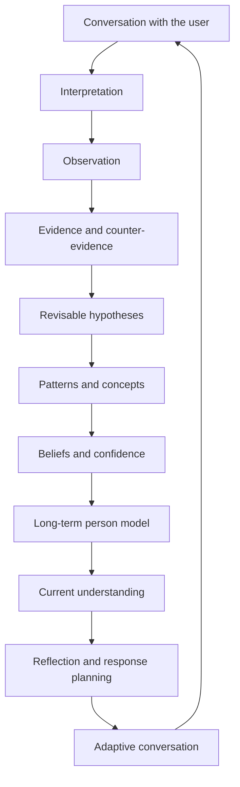

# ALMA AI — Public Architecture Overview

**Document type:** Public architecture overview  
**Version:** 1.0  
**Date:** 2026-10-09  
**Status:** Conceptual overview of the ALMA architecture  
**Project:** ALMA AI — Ethical AI for Long-Term Relationship Understanding

## 1. Overview

ALMA is an AI architecture designed to support **long-term, evidence-aware understanding of a person across conversations**. Its goal is not simply to answer the latest message, but to maintain a structured, revisable model of what has been expressed over time and use that context to support more coherent dialogue.

ALMA is being explored in the context of relationship dynamics and long-term compatibility. The architecture is intended to help organize observations, identify possible recurring patterns, preserve uncertainty, and adapt future conversations as understanding develops.

ALMA is a work in progress. This document describes the architectural approach and intended behavior; it is not a claim of clinical validation or proof that every described capability is fully implemented in every deployment.

## 2. Central principle

> **The language model reasons; ALMA manages persistent understanding.**

A language model can interpret language and propose possible meanings. ALMA's application and memory layers are responsible for deciding what information should be retained, how it relates to prior information, and whether the current understanding should be revised.

This separation is intended to prevent every generated statement from automatically becoming a durable claim about a person.

## 3. High-level architecture

The diagram presents the **conceptual information flow**, not a complete implementation diagram. Actual processing may include validation, filtering, retrieval, consolidation, and other supporting steps that are intentionally not specified here.

## 4. Main architectural layers

### Conversation and interpretation

ALMA receives messages in conversational context and interprets whether they contain information relevant to the person's long-term model. Ordinary conversation is not automatically treated as psychological evidence.

### Observation and evidence

An observation records information expressed in a conversation. Evidence links that information to a possible interpretation. Evidence may support a hypothesis, qualify it, or challenge it.

Repeated wording alone should not automatically be treated as independent confirmation.

### Revisable hypotheses

Hypotheses represent possible patterns that may help explain information expressed over time. They are provisional, not immutable personality facts. As additional evidence appears, a hypothesis may gain or lose support, be qualified, or be revised.

### Patterns and concepts

Related hypotheses can be considered together to identify a broader pattern. Higher-level concepts should remain grounded in the available observations and evidence rather than inventing hidden motives, causes, or diagnoses.

### Beliefs, confidence, and long-term understanding

ALMA maintains a structured model that distinguishes a possible pattern from a more strongly supported conclusion. Confidence and stability are different ideas: a claim may appear plausible without yet being established as a persistent pattern.

The model should remain revisable as the person's circumstances, statements, and available evidence change.

### Reflection and adaptive dialogue

The conversational layer can use the current model to maintain continuity, ask clarifying questions, and respond with relevant context. The intended loop is continuous: conversations provide new observations, and the model can be updated when there is sufficient support.

## 5. Design principles

- **Evidence before certainty.** Interpretations should be grounded in available information.
- **Uncertainty is explicit.** A hypothesis is not automatically a fact.
- **Counter-evidence matters.** New information can weaken or qualify an earlier interpretation.
- **Revisions preserve continuity.** The system should be able to update its understanding rather than treating every new formulation as unrelated.
- **Memory is not a transcript.** Long-term understanding is structured and selective, rather than a simple accumulation of every message.
- **Semantic relationships are not evidence.** Two ideas being related does not, by itself, prove either idea.
- **Conversation and cognitive updates are distinct.** Generating a response and changing the long-term model are separate responsibilities.

## 6. Ethical boundaries and intended use

ALMA is intended as a tool for reflection and understanding, not as a substitute for a person's own judgment or autonomy.

The architecture is guided by the following boundaries:

- It is not intended to diagnose mental-health conditions.
- It should not present uncertain interpretations as objective truths about a person.
- It should not infer hidden motives or psychological causes without adequate support.
- It should preserve nuance and context rather than reducing a person to a fixed label.
- It should support reflection and clearer communication, not manipulation, coercion, or social control.
- Any use involving personal conversations or sensitive information should account for consent, privacy, transparency, and appropriate data protection.

These are design goals and constraints, not a guarantee that every implementation already satisfies them in all circumstances.

## 7. What this overview does not disclose

This public document intentionally describes the architecture at a conceptual level. It does not specify internal prompts, source code, database schemas, model-routing configuration, processing thresholds, cache behavior, detailed pipeline order, or deployment-specific optimizations.

Those implementation details are outside the scope of this overview and may change independently as the project evolves.

## 8. Scope and maturity

ALMA is an evolving architecture. The diagram and descriptions communicate its core design model; they should not be interpreted as a formal verification of the production system or as evidence of validated psychological outcomes.

Claims about effectiveness, compatibility prediction, or real-world outcomes require separate empirical evaluation.

## 9. Authorship and version history

This document records a public description of the ALMA architecture as of **2026-10-09**. Keep dated releases and version history in the project's repositories so changes to the description can be tracked over time.

**Suggested filename:** `ALMA_PUBLIC_ARCHITECTURE.md`

---

*ALMA AI — Ethical AI for Long-Term Relationship Understanding*
